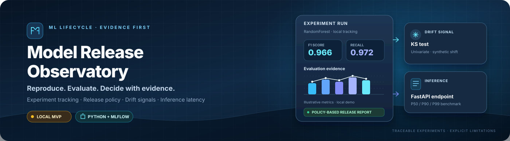

  

<h1 align="center">Model Release Observatory</h1>

  <strong>Reproducible experiments. Explicit release decisions. Observable model behavior.</strong> 
  A local-first MLOps portfolio MVP for tracking model runs, evaluating release criteria, detecting distribution shifts, and measuring inference latency.

  
  
  
  
  
  

  <a href="#the-problem">Problem</a> ·
  <a href="#what-is-implemented">Implemented scope</a> ·
  <a href="#architecture">Architecture</a> ·
  <a href="#quick-start">Quick start</a> ·
  <a href="#sample-evidence">Sample evidence</a> ·
  <a href="#audit-findings-and-limitations">Audit & limitations</a> ·
  <a href="#roadmap">Roadmap</a>

---

> [!IMPORTANT]
> **A completed portfolio MVP, not a production model platform.** The repository contains an end-to-end learning workflow for training a baseline model, recording MLflow runs, generating a threshold-based release report, testing a univariate drift signal, and serving predictions through FastAPI. The implementation still has important release-selection, input-validation, provenance, and test-coverage gaps. The checked-in reports are evidence snapshots from a local run, not a live monitoring system or an independently reproduced benchmark.

## The problem

A trained model is only one part of a reliable release. Before promoting a candidate, an engineer should be able to answer:

- Which dataset and configuration produced this artifact?
- How did the candidate perform against defined evaluation metrics?
- Did it satisfy the current release policy?
- Does new input data differ from the reference distribution?
- What latency did the inference endpoint exhibit under a documented test setup?
- Can a reviewer inspect the evidence behind the decision?

Model Release Observatory demonstrates a small, explainable version of that lifecycle. It deliberately uses a lightweight scikit-learn model and the built-in Breast Cancer Wisconsin (Diagnostic) dataset so the default workflow can run locally without a GPU or paid cloud service.

## What is implemented

| Capability | Current implementation | Boundary / limitation |
|---|---|---|
| Baseline training | RandomForest classifier; stratified train/test split; configured random seed; command-line estimator/depth options | Only one built-in dataset and one model family are included |
| Experiment tracking | MLflow experiment, parameters, metrics, tags, dataset fingerprint, and model artifact | Fingerprint covers the training feature matrix only; it is not complete dataset lineage or a security checksum |
| Run comparison | Sorts active runs by F1 and prints the top run and runner-up | Comparison is F1-first and does not perform a complete statistical or task-specific comparison |
| Release policy | Writes a JSON report using minimum F1 and recall thresholds of 0.95 | The inference API does not currently enforce that it loads the report's approved run |
| Drift check | Kolmogorov–Smirnov test on the single feature named mean radius; includes an unchanged sample and a synthetic shift | Demonstration only; no production data stream, alerting, multivariate monitoring, or model-quality feedback loop |
| Inference API | FastAPI endpoint at <code>POST /predict</code> with a dynamically loaded MLflow model | Input schema is minimal; model selection and readiness behavior need hardening |
| Latency benchmark | Sends 100 sequential requests and records P50, P90, P99, mean latency, and successful count | No concurrent load, percentile confidence interval, benchmark-environment metadata, or production SLO claim |
| Automated tests | Dataset split/stratification and drift/no-drift tests | No API tests, release-policy tests, model-selection tests, benchmark tests, or configured GitHub Actions CI workflow |

The checked-in <code>docs/PROJECT_STATE.md</code> marks the planned local MVP as complete. That is a project milestone, not proof of production readiness. The concrete boundaries above define what the code currently demonstrates.

## Architecture

~~~mermaid
flowchart TD
    A[Built-in dataset] --> B[Stratified train/test split]
    B --> C[RandomForest training]
    C --> D[MLflow run and artifact]
    D --> E[Run comparison]
    D --> F[Release policy evaluation]
    F --> G[JSON release evidence]
    A --> H[Reference feature distribution]
    H --> I[KS drift check]
    I --> J[JSON drift report]
    D --> K[FastAPI model loading]
    K --> L[POST /predict]
    L --> M[Sequential latency benchmark]
    M --> N[JSON latency report]
~~~

The architecture is intentionally local-first. MLflow tracks the experiment and artifacts; scripts create inspectable JSON reports; FastAPI exposes a lightweight inference route. The current implementation does not include a production registry, deployment promotion service, live drift ingestion, scheduled monitoring, or automated rollback.

## Technology

| Layer | Technology |
|---|---|
| Language and data | Python, pandas, NumPy |
| Model | scikit-learn RandomForest classifier |
| Experiment tracking and artifacts | MLflow |
| Statistical drift signal | SciPy Kolmogorov–Smirnov two-sample test |
| Inference API | FastAPI, Pydantic, Uvicorn |
| HTTP benchmark client | requests |
| Tests | pytest |
| Reports | JSON files under <code>reports/</code> |
| Local tracking state | MLflow's local tracking/artifact directory by default |

The repository's <code>requirements.txt</code> currently pins a large set of direct and transitive packages, including a Windows-specific <code>pywin32</code> dependency without a platform marker. This should be cleaned up into a deliberate dependency specification and a reproducible lock strategy. Cross-platform installation has not been verified as part of this audit.

## Quick start

### Prerequisites

- Python compatible with the pinned dependencies (the project documentation targets Python 3.10+).
- PowerShell on Windows, or a terminal on another platform.
- A local environment with enough disk space for Python packages, MLflow run metadata, and model artifacts.

### 1. Create an environment and install dependencies

From the repository root in PowerShell:

~~~powershell
py -3 -m venv venv
.\venv\Scripts\Activate.ps1
python -m pip install --upgrade pip
python -m pip install -r requirements.txt
~~~

On macOS/Linux, create and activate a virtual environment with that platform's Python command. Note that the current dependency file includes an unconditional Windows-specific package; cross-platform installation may require a dependency-file cleanup before the same command works everywhere.

### 2. Train and track two runs

~~~powershell
python src/train.py --run_name "baseline_v1" --n_estimators 100 --max_depth 5
python src/train.py --run_name "candidate_v1" --n_estimators 200 --max_depth 10
~~~

Training uses a stratified split and fixed random seed, then logs parameters, metrics, dataset fingerprint tags, and a model artifact to MLflow. Run at least one successful training experiment before starting the inference server.

### 3. Compare runs and evaluate the release policy

~~~powershell
python src/compare_runs.py
python src/release.py
~~~

The comparison script ranks active runs by F1. The release script evaluates the top-ranked run against these current thresholds:

| Metric | Threshold |
|---|---:|
| F1 score | 0.95 |
| Recall | 0.95 |

The generated release evidence is written to <code>reports/release_report.json</code>. The policy is a teaching example and must be aligned with the task's risk profile before it is used for any real release decision.

### 4. Run the drift demonstration

~~~powershell
python -m src.drift_check
~~~

This script compares the reference distribution of one feature with a sample from the same dataset, then evaluates a synthetically shifted version and writes <code>reports/drift_report.json</code>. A detected distribution shift is a reason to investigate; it does not prove that model quality has degraded.

### 5. Start the inference API

~~~powershell
python -m uvicorn src.app:app --host 127.0.0.1 --port 8000
~~~

Local endpoints:

- <code>GET /health</code> — reports whether the model was loaded.
- <code>POST /predict</code> — accepts a JSON object containing a list of exactly 30 numeric features.
- <code>/docs</code> — interactive FastAPI documentation.

The API binds to loopback in this example. Keep it local during development; authentication, rate limiting, production deployment configuration, and hardened readiness behavior are not implemented.

### 6. Benchmark inference latency

In a second terminal, with the same environment active and the API running:

~~~powershell
python src/latency_benchmark.py
~~~

The benchmark writes <code>reports/latency_report.json</code>. It sends sequential requests to a local server; it is not a load test and should not be used to claim production capacity.

### Optional: inspect MLflow runs

~~~powershell
mlflow ui --backend-store-uri ./mlruns --host 127.0.0.1 --port 5000
~~~

Open <code>http://127.0.0.1:5000</code> to inspect the local experiment history, if the runs were created in the default local tracking directory.

## Sample evidence

The repository includes generated report snapshots. They are useful for understanding the output format but do not prove that the current environment will reproduce identical numbers.

| Report | Checked-in snapshot | Interpretation |
|---|---|---|
| Baseline metrics | Precision 0.9589 · Recall 0.9722 · F1 0.9655 · ROC-AUC 0.9934 | One saved evaluation result; not a guarantee of performance on new data |
| Release decision | Candidate <code>candidate_v2</code> marked <code>APPROVED</code> against F1 and recall thresholds of 0.95 | A script-generated policy result; the API does not yet load only this approved run |
| Drift report | One unchanged sample is not flagged; a synthetic shift of mean radius is flagged | A controlled example of a statistical signal, not validation of production drift detection |
| Latency report | 100 total requests; 100 successful in the saved run; P50 24.25 ms, P90 24.73 ms, P99 25.39 ms | Historical local snapshot; hardware, concurrency, and complete environment metadata are not recorded |

These values come from the committed files under <code>metrics/</code> and <code>reports/</code>. Treat them as illustrative evidence from a prior local run, not as freshly benchmarked results from this audit.

## Audit findings and limitations

The following are source-level findings from the current default branch. This review does not claim to have executed training, started the API, reproduced the reports, or run a dedicated security scan.

### P0 — Release policy and serving can disagree

- <code>src/release.py</code> selects the top active MLflow run by F1 and produces an approval report after checking F1 and recall thresholds.
- <code>src/app.py</code> independently selects the highest-F1 run and loads its artifact. It does not require that run to be explicitly marked approved or match the run ID in the release report.
- A run can therefore be selected for serving even when the release policy would reject it. Bind inference to an explicitly approved model version and add regression tests.

### P0 — This is not a clinical model

This project uses the Breast Cancer Wisconsin (Diagnostic) dataset strictly as a small ML lifecycle demonstration. It is not validated for clinical use, diagnosis, screening, treatment, or decision-making about a real person.

The dataset's target labels are ordered as malignant (0) and benign (1). The current scikit-learn metric calls use the default positive class of 1, so the logged recall/F1 metrics emphasize the benign class unless the code explicitly selects another positive label. The API's returned <code>probability</code> is also the predicted probability for class 1 (benign), not a generic probability of malignancy. Rename and document this field, define the intended class semantics, and never present this demo as medical guidance.

### P1 — Inference input and readiness need stricter contracts

- The request accepts a generic list of floats and checks only that its length is 30. The original feature names/order, NaN/infinity values, and domain constraints are not fully validated.
- The inference DataFrame uses positional numeric columns rather than the original named feature columns used at training. This can produce scikit-learn feature-name warnings and leaves the API contract fragile.
- <code>/health</code> returns HTTP success even if the model did not load, with <code>model_loaded: false</code>. Separate liveness from readiness and make model-load failures observable.
- There are no authentication, authorization, rate-limit, or production deployment controls. Keep the service bound to a trusted local interface.

### P1 — Provenance and release evidence are partial

- The current dataset fingerprint is MD5 over the training feature matrix only. It does not include labels, the full dataset version, preprocessing configuration, or all evaluation settings; it should not be treated as a complete lineage record or security proof.
- Release report contents and the model loaded by the API are not tied together by a verified approved run ID.
- <code>compare_runs.py</code> ranks by F1 and shows the runner-up; it does not assess uncertainty, repeatability across seeds, or whether the difference is meaningful.
- The checked-in JSON reports may become stale when training or configuration changes. Attach run IDs, timestamps, source revision, dependency/runtime versions, and evaluation configuration to future report generations.

### P1 — Drift and latency demonstrations are deliberately narrow

- Drift detection examines one numeric feature with a two-sample KS test and a fixed p-value threshold. It does not ingest live production data, handle multivariate changes, correct for repeated testing, monitor label quality, or link drift to downstream performance.
- The synthetic-shift example demonstrates that the statistic responds to a constructed change. It is not evidence of detection accuracy under real operational conditions.
- The latency benchmark uses 100 sequential requests to loopback. It does not measure concurrent load, service saturation, cold-start effects comprehensively, resource usage, or tail-latency confidence intervals. It also lacks recorded machine and environment details.

### P2 — Quality and dependency hygiene

- The current tests cover dataset split/stratification and two drift scenarios. The API, model-load path, input schema, release-policy edge cases, artifact selection, comparison script, and benchmark failure modes lack tests.
- No <code>.github/workflows/</code> CI workflow was present in the repository tree at the time of this audit. Builds and tests are therefore not automatically verified on every change.
- <code>requirements.txt</code> includes many transitive packages and a Windows-specific dependency without a marker. Maintain a small direct-dependency file and a repeatable resolution/locking process.
- Model artifacts serialized with cloudpickle must be treated as trusted executable artifacts. Only load models from a controlled local MLflow store; do not load user-supplied or untrusted model files.

A successful training run or an <code>APPROVED</code> JSON report does not, by itself, make the serving system release-safe. The release decision, the artifact selected for inference, and the evidence shown to reviewers must refer to the same verified model version.

## Roadmap

### P0 — Make serving honor release decisions

- Load the exact run ID that passed the release policy, not just whichever run has the highest F1.
- Fail readiness when the approved artifact cannot be loaded.
- Define explicit target-label semantics and name the returned probability accordingly.
- Add regression tests for rejected candidates, missing artifacts, and mismatch between the release report and serving artifact.

### P1 — Improve API contracts and provenance

- Validate named features, feature order, finite numeric values, and request bounds.
- Record the complete dataset fingerprint, labels, split configuration, code revision, and runtime/dependency metadata.
- Make release reports deterministic and tie every report to an exact model/run/artifact identifier.
- Add API, training, release-gate, and artifact-selection tests.

### P1 — Make drift and benchmark evidence more useful

- Generalize drift checks across selected features with explicit missing-value policy and documented statistical caveats.
- Keep the synthetic examples, but add tests for tiny samples, constant distributions, missing values, and threshold boundaries.
- Record benchmark environment metadata and request failures; add a separate concurrent load-test harness before making throughput claims.

### P2 — Strengthen the engineering workflow

- Add GitHub Actions for dependency installation, lint/format checks, tests, and a lightweight deterministic training/release smoke test.
- Replace the oversized mixed dependency freeze with clean direct dependencies plus a lock/resolution strategy.
- Improve logging, configuration, and API error contracts; avoid printing sensitive or uncontrolled artifact details.
- Keep README examples, report snapshots, and project-state notes aligned with verified code.

## Repository layout

~~~text
.
├── src/
│   ├── dataset.py              # Built-in dataset and stratified split
│   ├── train.py                # Training and MLflow logging
│   ├── compare_runs.py         # F1-ranked run comparison
│   ├── release.py              # Threshold policy and JSON evidence
│   ├── drift_check.py          # Univariate KS drift demonstration
│   ├── app.py                  # FastAPI inference endpoint
│   └── latency_benchmark.py    # Sequential local latency benchmark
├── tests/
│   ├── test_data.py
│   └── test_drift.py
├── metrics/
│   └── baseline.json
├── reports/
│   ├── release_report.json
│   ├── drift_report.json
│   └── latency_report.json
├── docs/
├── assets/
│   └── model-release-observatory-banner.svg
├── requirements.txt
└── LICENSE
~~~

## Contributing

Issues and focused pull requests are welcome. Changes to the evaluation policy, class semantics, dataset split, model-loading path, or drift logic should include regression tests and updated evidence. Do not describe a model as approved for serving unless the exact artifact was validated by the current release policy.

---

## Creator, Developer & Maintainer

**Created, designed, developed, and maintained by [Nurul Faiyaz](https://github.com/tracolerd).**

  
  
  
  
  
  
  

  <a href="https://www.facebook.com/faiyaz.888">Facebook</a> ·
  <a href="https://www.instagram.com/tracolerd">Instagram</a> ·
  <a href="https://www.linkedin.com/in/faiyaz-xyz">LinkedIn</a> ·
  <a href="https://x.com/faiyaz_explores">X / Twitter</a> ·
  <a href="https://github.com/tracolerd">GitHub</a> ·
  <a href="mailto:scrollfaiyaz@gmail.com">Email</a> ·
  <a href="https://nurul-faiyaz.netlify.app/">Portfolio</a>

## License

MIT. See [LICENSE](LICENSE).
